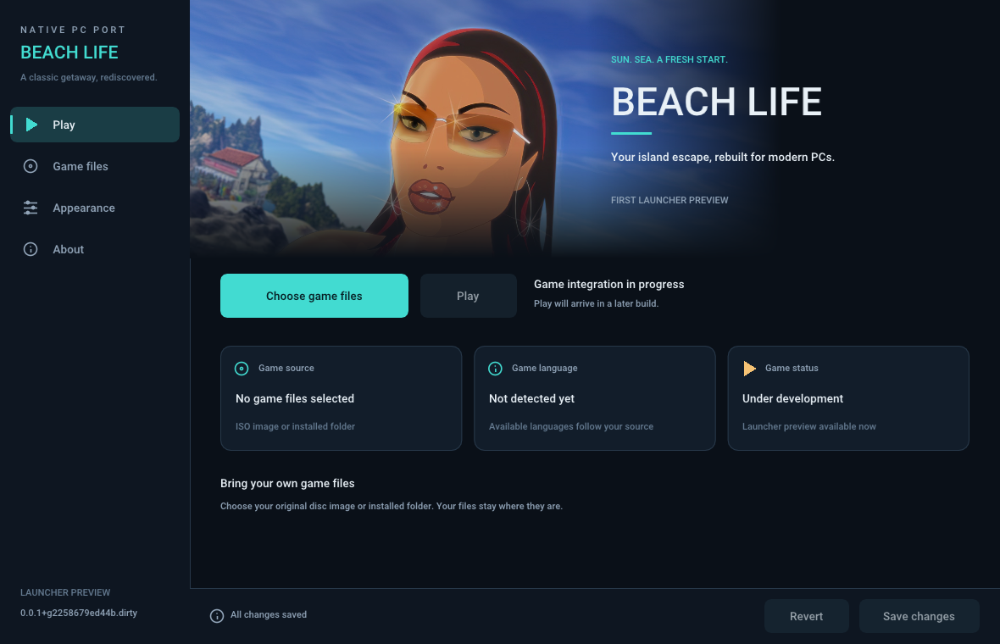

# Beach Life recomp

[](docs/PROGRESS.md#readme-badges)
[](docs/PROGRESS.md#readme-badges)

A native C++ port of **Beach Life** (Deep Red Games / Eidos, 2002), known in
North America as **Virtual Resort: Spring Break**, for Windows, Linux and macOS.

Faithful reconstruction advances through [source patches](patches/README.md)
over a pinned baseline in this repository. New launcher, data, runtime and native platform code lives in
`src/`. The original executable never runs inside the port.

## Disclaimer

This project is AI-assisted. English is not my native language, and most of the
documentation has been rewritten by LLMs.

I am a software engineer and have been working on software projects for more
than 30 years: from the demoscene, to freelancing in the games industry, to
failed startup dreams, to big and heavy projects in the commercial market.

This project is a labor of love for a game I remember enjoying, and for many
hours of happy memories playing it with my girlfriend, now my wife, more than
20 years ago.

The decompilation and recompilation are crafted by hand, and most of the code is
handwritten. LLMs helped me analyze the crash reports of the many bugs that
crashed the game. And hey, you will enjoy many more bugs with this project,
because neither I nor any LLM is perfect.

I am also bad at UI and design, worse than any AI, so LLMs help me there too. I
value the time I invest in hard problems more than time spent on something that
just makes me depressed. Do you want to step in here with your talent? Yes,
please reach out to me by
[opening an issue](https://github.com/yannicksuter/beachlife-recomp/issues).

This project shares a lot of code with
[Recharged](https://github.com/previouslevelgames/recharged), a port of a
Nintendo Wii game into which I have already sunk thousands of hours.

I know that AI creates anxiety. In the hands of professionals, AI is an amazing
tool, and the results speak for themselves. Society is learning to use these
tools, just as we had to learn to use a chainsaw: dangerous tools, but
incredible efficiency multipliers when used the right way.

If you have a personal problem with AI, please ignore this project. I do it for
me, not at all to please you. If you enjoy the result, or if you want to share
your excitement with me or contribute great ideas, you will make my day even
nicer. Otherwise, I am happy to ignore you completely :) I don't challenge your
dislike of AI, but then please be consistent and delete your operating system,
your browser and your phone: more or less everything you use now and will use
in the future.

We are all on a learning journey: we have to live through this change and find
our place in this digital world on steroids.

## Current status

Every native package includes the playable decompiled game.
Select your own supported English ISO in the launcher and press **Play** to
prepare its files, then enter the intro, menus and game. Prepared files work
with the ISO disconnected. The original executable is never launched.

On the **Gameplay** page, **Skip intro** starts at the main menu
and **Mouse wheel zoom** controls the camera. Both are off by default. Display,
interface and update settings remain available in the launcher. The independent
[data tool](docs/DATA.md) can inspect and prepare the same local content.

This is an early playable reconstruction with known limits. The UK English disc,
the European disc (French, Italian, German, Spanish, Polish), the US *Virtual
Resort: Spring Break* disc and the 2006 PLAY magazine cover disc are supported,
all played by the reconstructed UK 1.1 code; complete gameplay parity remains work in progress. Linux and Windows have local headless scenario, sandbox and input
stress checks. macOS validation is limited to CI's headless generated-data checks;
Metal presentation and gameplay with retail data still need testing on a Mac.
Steam Deck's package checks its runtime ABI; on-device gameplay is not qualified.

The intended graphics backends are DX12/Vulkan on Windows, Metal on macOS, and
Vulkan on Linux. The launcher uses pinned SDL3 and Dear ImGui, following
Recharged's design; the game window uses SDL3's GPU API on those backends.



## Build

Requires CMake 3.25+, Ninja, Python 3.10+, Git and a C++20 compiler:

```sh
python3 tools/setup_dependencies.py
cmake --workflow --preset release
./build/release/beachlife
```

See [BUILDING](docs/BUILDING.md) for release builds, macOS and Windows.

## Binaries and releases

PRs to `main` and `stable` produce native packages for Windows x86_64, Linux
x86_64, Steam Deck and macOS (one universal app for Apple silicon and Intel,
also as a disk image), each with the launcher and the experimental decompiled
game. `main` is the development
branch; promotion to `stable` goes through a tested `main` → `stable` PR.

Promotion PRs receive temporary test prereleases. Merging builds the stable
commit and publishes the version in `CMakeLists.txt` as the latest release,
titled and described by the merged PR. Existing versions are preserved; raise
the CMake version for another release.

Read [RELEASES](docs/RELEASES.md) for the complete process and
[INSTALL](docs/INSTALL.md) for package contents and startup.

## Original game files

No original executables, DLLs, disc images or gameplay data are
committed or included in packages. Playing requires the user's own game data.
Development inputs belong under ignored `orig/` or outside the
repository; see [orig/README.md](orig/README.md). CI uses generated fixtures and
builds without game files. The launcher artwork, a remaster of Beach Life art,
and the game's logo are documented in [launcher resources](assets/launcher/README.md).
The original application icon has separate [provenance](assets/app/README.md).

## Layout

```text
CMakeLists.txt        native targets and the sole release version
CMakePresets.json     shared local/CI configure, build and test presets
cmake/               platform configuration and toolchains
src/bootstrap/       native entry point and command line
src/data/            read-only game sources and the headless data tool
decomp/              frozen reconstruction baseline and matching setup
src/launcher/        graphical launcher, source selection and preferences
src/platform/        native graphics (the game window), audio, input and file services
src/runtime/         the game loop and reconstructed-game integration
extern/              pinned dependency checkouts; builds use prepared exports
patches/             reconstructed methods, native adaptations and optional tweaks
assets/              launcher resources and their provenance
tools/               versioning, packaging and release helpers
tests/               generated-fixture and native startup checks
docs/                architecture, building, installation and releases
```

New retail reconstruction belongs in `patches/beachlife-decomp/`. Matching,
the game and optional native subsystem tests consume the pinned baseline plus
ordered patches in build trees. See [subsystem tests](docs/BUILDING.md#reconstructed-subsystem-tests),
[ARCHITECTURE](docs/ARCHITECTURE.md) and [patch rules](patches/README.md).

The [progress report tool](docs/PROGRESS.md) turns a local audited split inventory
and matching results into an offline HTML overview of methods, source units,
matching, native linking and unmapped coverage.
