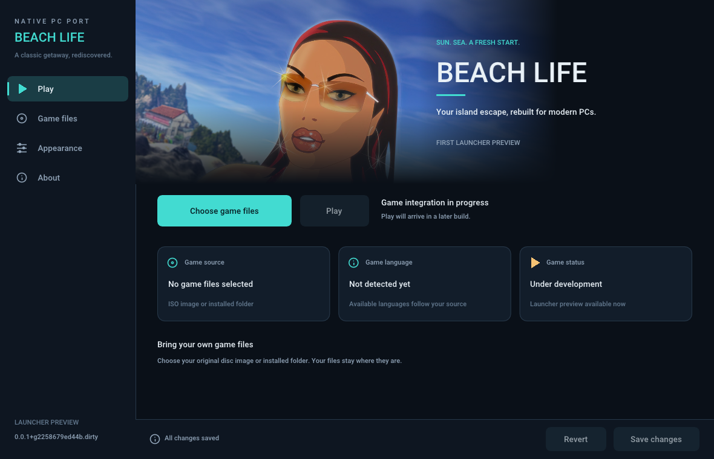

# Beach Life recomp

A native C++ port of **Beach Life** (Deep Red Games / Eidos, 2002), known in
North America as **Virtual Resort: Spring Break**, for Windows, Linux and macOS.

Faithful reconstruction lives in [decomp/](decomp/README.md) within this
repository. New launcher, data, runtime and native platform code lives in
`src/`. The original executable never runs inside the port.

## Current status

The first graphical launcher and the build/release pipeline are implemented.
Open it to select your ISO disc image, remember it, and adjust display,
diagnostics and interface settings. Browse, drag-and-drop, manual paths, save
and revert work. The launcher updates itself from published releases or pull
requests' test builds.
The independent [data tool](docs/DATA.md) indexes and reads files directly
from an ISO, reads installer cabinets and prepares verified local game data
for a read-only VFS. Play opens the game window, then checks, prepares and mounts
those files on a worker behind its loading screen. Completed setup works with
the ISO disconnected.
**Game files → Preview title screen** displays the original title artwork from
the prepared data in the native window. The preview uses the selected graphics
API and display settings; Esc returns to the launcher. It is an image viewer,
not the reconstructed game menu.
The observed English data layout is supported; broader language detection and
gameplay are still ahead. Play opens the game window on
Direct3D 12, Vulkan or Metal and runs an empty game loop until the game code is
reconstructed. Decompilation and native development advance together.

The intended graphics backends are DX12/Vulkan on Windows, Metal on macOS, and
Vulkan on Linux. The launcher uses pinned SDL3 and Dear ImGui, following
Recharged's design; the game window uses SDL3's GPU API on those backends.



## Build

Requires CMake 3.25+, Ninja, Python 3.10+, Git and a C++20 compiler:

```sh
python3 tools/setup_dependencies.py
cmake --workflow --preset debug
./build/debug/beachlife
```

See [BUILDING](docs/BUILDING.md) for release builds, macOS and Windows.

## Binaries and releases

PRs to `main` and `stable` produce native packages for Windows x86_64, Linux
x86_64, Steam Deck, macOS ARM64 and macOS x86_64. `main` is the development
branch; promotion to `stable` goes through a tested `main` → `stable` PR.

Promotion PRs receive temporary test prereleases. Merging builds the stable
commit and creates a draft release candidate for the version in
`CMakeLists.txt`. The owner reviews and publishes the draft. Existing versions
are preserved; raise the CMake version for another candidate.

Read [RELEASES](docs/RELEASES.md) for the complete process and
[INSTALL](docs/INSTALL.md) for package contents and startup.

## Original game files

No original executables, DLLs, disc images or gameplay data are
committed or included in packages. The completed port will require the user's
own game data. Development inputs belong under ignored `orig/` or outside the
repository; see [orig/README.md](orig/README.md). CI uses generated fixtures and
builds without game files. The launcher artwork, a remaster of Beach Life art,
and the game's logo are documented in [launcher resources](assets/launcher/README.md).
The original application icon has separate [provenance](assets/app/README.md).

## Layout

```text
CMakeLists.txt        native targets and the sole release version
CMakePresets.json     shared local/CI configure, build and test presets
cmake/               platform configuration and toolchains
src/bootstrap/       native entry point and command line
src/data/            read-only game sources and the headless data tool
decomp/              faithful reconstruction, target identity and matching tools
src/launcher/        graphical launcher, source selection and preferences
src/platform/        native graphics (the game window), audio, input and file services
src/runtime/         the game loop and reconstructed-game integration
extern/              pinned dependency checkouts; builds use prepared exports
patches/             faithful and optional tweak patch series
assets/              launcher resources and their provenance
tools/               versioning, packaging and release helpers
tests/               generated-fixture and native startup checks
docs/                architecture, building, installation and releases
```

Retail code lives only in `decomp/`. The port will consume revision-identified
exports and apply patches to build trees. New host code lives here. See
[ARCHITECTURE](docs/ARCHITECTURE.md) and [patch rules](patches/README.md).
