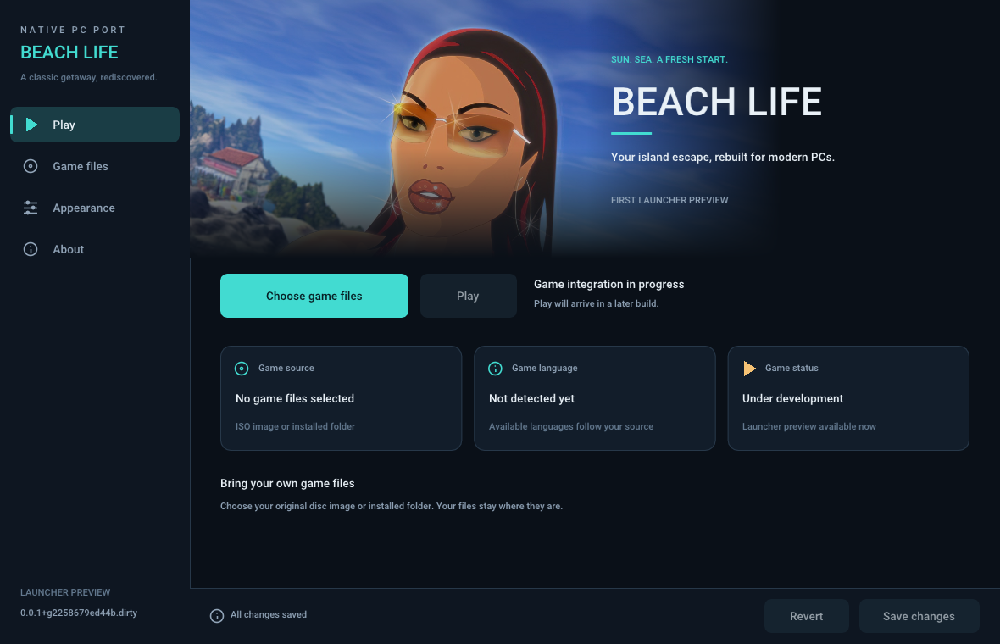

# Beach Life recomp

[](docs/PROGRESS.md#readme-badges)
[](docs/PROGRESS.md#readme-badges)

A native C++ port of **Beach Life** (Deep Red Games / Eidos, 2002), known in
North America as **Virtual Resort: Spring Break**, for Windows, Linux and macOS.
The game code is decompiled from the retail executable, byte-matched against the
original compiler and recompiled against a new SDL3 host. The original
executable never runs.

## Status

Every native package includes the playable decompiled game. It is an early
reconstruction with known limits. Select your own ISO in the launcher and press
**Play**: the game files are prepared once and keep working with the disc
disconnected. The UK English, European (French, Italian, German, Spanish,
Polish), US *Virtual Resort: Spring Break* and 2006 PLAY cover discs are
supported, all played by the reconstructed UK 1.1 code.

Linux and Windows are tested with headless scenario, sandbox and input stress
runs. macOS is only checked in CI with generated data; Metal presentation and
play with retail data still need testing on a Mac, as does play on a Steam Deck.
The game window uses SDL3's GPU API: DX12/Vulkan on Windows, Metal on macOS,
Vulkan on Linux.



## Thanks

Special thanks to **Cezary Średnicki**, who decompiled a large part of Beach
Life on his own and generously allowed this project to integrate his work. His
sources have already helped match many functions here.

Much of the launcher and platform code is shared with
[Recharged](https://github.com/previouslevelgames/recharged), a port of a
Nintendo Wii game.

## About

Beach Life is a game I remember fondly: I spent many happy hours playing it with
my girlfriend, now my wife, more than 20 years ago. This project is a personal
labor of love by a software engineer with more than 30 years of experience.

It is developed with AI assistance. AI agents do much of the decompilation and
byte-matching work under my direction: I set the goals and rules, review the
results and integrate them. LLMs also help analyze crash reports and edit the
documentation, as English is not my native language. Bugs remain; neither I nor
any tool is perfect. If AI-assisted work is not something you want to engage
with, this project may not be for you, and that is fine.

Feedback and help are welcome, especially with user interface and visual
design: please [open an issue](https://github.com/yannicksuter/beachlife-recomp/issues).

## Build

Requires CMake 3.25+, Ninja, Python 3.10+, Git and a C++20 compiler:

```sh
python3 tools/setup_dependencies.py
cmake --workflow --preset release
./build/release/beachlife
```

See [BUILDING](docs/BUILDING.md) for release builds, macOS and Windows.

## Releases

Pull requests build packages for Windows x86_64, Linux x86_64, Steam Deck and
macOS (one universal app, also as a disk image). `main` is the development
branch; a tested `main` → `stable` PR publishes the version set in
`CMakeLists.txt` as the latest release. See [RELEASES](docs/RELEASES.md) and
[INSTALL](docs/INSTALL.md).

## Original game files

No original executables, DLLs, disc images or game data are committed or
packaged; playing requires your own game data. Development inputs stay in the
ignored `orig/` folder ([orig/README.md](orig/README.md)), and CI builds and
tests with generated fixtures. The launcher artwork and logo are documented in
[launcher resources](assets/launcher/README.md), the application icon in its
[provenance](assets/app/README.md).

## Documentation

- [ARCHITECTURE](docs/ARCHITECTURE.md): repository layout, source boundaries
  and how the game is built.
- [Patches](patches/README.md): how reconstructed code is stored over the
  pinned baseline.
- [DATA](docs/DATA.md): the data tool that inspects and prepares game files.
- [PROGRESS](docs/PROGRESS.md): the progress report and the README badges.
