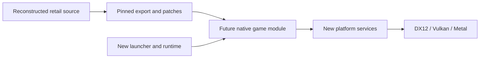

# Architecture

The native host and the matching decompilation develop together. The current
host is a small C++20 bootstrap; its CMake build, native packages and release
pipeline are usable before a game module exists.

## Source and build boundaries

The host contains only new bootstrap, launcher, runtime and platform code.
Retail source belongs in beachlife-decomp. The future game module will compile
its pinned `include/`, `libs/` and `src/` exports after applying the faithful
patch series. Intentional behavior changes stay in a separate optional series,
with tweaks off by default. Never edit a dependency checkout in place.

The matching build uses the original 32-bit compiler and compares functions
against the target executable. The native build uses CMake/Ninja and modern
C++20 compilers. These are different build products; a successful native build
is not a matching result.

The host is 64-bit. x86_64 and ARM64 are distinct architectures, even though
both targets use little-endian storage. File/save layouts, pointer widths,
`long`, `wchar_t`, alignment and floating-point behavior need explicit handling.

## Platform direction

| Service | Native direction |
| --- | --- |
| Window, input, events, timing and audio device | SDL3 |
| Windows graphics | Dawn native D3D12, with Vulkan selectable |
| macOS graphics, ARM64 and Intel | Dawn native Metal |
| Linux graphics | Dawn native Vulkan |
| Game files | Read/seek interface over installed folders, images and installer archives |
| Settings and saves | Writable user storage, separate from read-only game data |

SDL3, Dawn and the game module are not yet integrated. Each dependency will be
pinned and built from prepared source when introduced. The host does not need
Wii/GX compatibility or a browser runtime.

The retail DirectDraw/GDI operations determine whether adaptation belongs at
the API boundary or at a narrow game-renderer interface. That mapping remains
open; the native backend requirements are fixed. Synthetic GPU diagnostics
will establish each backend before retail rendering is connected. Compilation
and command-line startup alone do not establish GPU or gameplay compatibility.

## Data and game integration

Start with installed-folder reads, then ISO 9660/Joliet and InstallShield
cabinet access. Direct reads should avoid requiring a permanent extracted game
tree; large compressed members need measured seeking/caching experiments.
Keep case/slash compatibility without allowing paths to escape the source.

Asset previews and subsystem harnesses can advance while matching is incomplete.
Full game launch requires all reachable game code and dependencies in source.
An asset viewer, synthetic scene or stubbed menu does not meet that condition.
The original executable and middleware DLLs are never executed by the port.

Audio decoders, video playback, text/font behavior and save interoperability
are separate increments. Remaster assets and player-visible changes remain
optional layers over the faithful baseline.

## Builds and promotion

The same presets serve local builds and Actions. CMake's `project(... VERSION)`
is authoritative; generated identity adds the source SHA, dirty state, channel,
PR and workflow run. Package manifests record provenance and payload hashes.

PRs build native artifacts for every supported package target. Stable promotion
requires all platform jobs, the Windows package smoke and the aggregate package
validation. Stable rebuilds the merged commit and drafts its CMake version.
Final publication reuses the candidate assets. See [BUILDING](BUILDING.md) and
[RELEASES](RELEASES.md). Packages contain declared outputs and notices, never a
recursive copy of the checkout or original game data.
