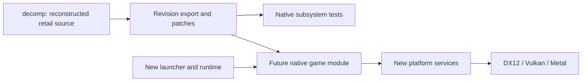

# Architecture

The native host and the matching decompilation develop together. The current
host is a C++20 graphical launcher; its CMake build, native packages and release
pipeline are usable before a game module exists. The launcher uses SDL3 and
Dear ImGui with settings/source logic independent of rendering.

## Source and build boundaries

This repository owns both tracks. `src/` contains new bootstrap, launcher,
data, runtime and platform code. `decomp/` is the frozen reconstruction baseline;
new retail methods and changes belong in `patches/beachlife-decomp/`. No sibling
checkout is required. The source preparation tool exports the full local commit
in `patches/beachlife-decomp/source.json` and records its tree and file hashes.
Both builds apply `reconstruction-series`; native builds then apply the faithful
portability `series`. Matching retains the original compiler and ABI. Normal
Play's configuration and VFS file libraries, plus optional native subsystem
tests, consume that export. The remaining game code uses the same boundary.
Intentional behavior changes stay in a
separate optional series, with tweaks off by default. Third-party dependencies
remain immutable pins; never edit their checkouts in place.

The matching build uses the original 32-bit compiler and compares functions
against the target executable. The native build uses CMake/Ninja and modern
C++20 compilers. These are different build products; a successful native build
is not a matching result.
The initial candidate is Visual C++ 6.0 SP4. Its compiler stamp agrees with
the dominant Rich-header record, and the generated PDB/comparison fixture is
verified. 63 reconstructed game functions match after address normalization,
totaling 4,942 bytes. 30 functions also match all 1,436 raw bytes exactly.
Separate reconstructed library support totals 35 bytes across three methods.
Four methods totaling 633 bytes also match after address normalization; their
game/library provenance remains unclassified and is counted separately.
One of those methods matches all 94 raw bytes exactly.
The full game layout remains unknown.
See [matching setup](../decomp/README.md).

Game comparisons verify the prepared target's declared SDK header hashes before
compilation and again after building and comparing. Results record those hashes;
changed headers or pins invalidate the comparison.

Prepared matching targets can opt into `stdcall_imports`, a DLL mapping with
`export_names` (`decorated` or `undecorated`) and a `symbols` mapping from source
names to x86 stack-byte counts. The build generates import metadata and verifies
the requested names against both original and rebuilt PE import tables. It does
not copy DLL code or execute the comparison image. Native service adaptations
remain separate from this original-ABI link support.

`beachlife_reconstructed_tga` compiles seven matched helpers with the modern
compiler and host CRT. Its generated test executable checks data conversion
and ownership; it does not link those helpers into the production launcher.
`beachlife_reconstructed_files` runs the three allocating/size helpers and the
startup configuration reader through an explicit VFS binding with fixed-width
size arithmetic. `beachlife_reconstructed_config` compiles eight matched helpers
for scanning, counting tokens and classifying values. `beachlife_reconstructed_config_tokens` exercises
token initialization and cleanup through the host allocator.
`beachlife_reconstructed_config_allocation`
qualifies bounded table allocation with the legacy default failure result.
`beachlife_reconstructed_config_parser` combines matched name/value assignment,
decimal-prefix conversion and token parsing with the existing scanner and token
libraries. Generated fixtures qualify bounded records and ownership with
successful allocations; arbitrary fractional arithmetic and allocation failure
remain separate boundaries.
`beachlife_reconstructed_config_loading` connects the matched file orchestration
to those libraries through the existing VFS reader. Generated files qualify the
three-open sequence, fixed-width sizes, bounded complete reads, token allocation
failure and ownership after the mount ends. Uninitialized read tails, unchecked
temporary/payload allocation failure and arbitrary numeric parity remain outside
the executed domain.
The real configuration filename constructor is qualified through the VFS,
including field initialization before the first open and the selected `2.5`
float value. `beachlife_reconstructed_startup_config` adds the actual outer
owner, append and cleanup chain. Its generated tests qualify nonempty typed
records, owner publication, duplicate names, copied strings, bounded values
and global reset after destruction. Configuration lookup, empty-owner cleanup,
general error/unwind paths and general floating-point parity remain separate,
as do the complete image parser and allocating constructor.
The configuration/file libraries now build for normal Play independently of
`BUILD_TESTING`, through the same pinned export and verification target.
`beachlife_startup_configuration` owns the host input/lifetime boundary around
the actual reconstructed constructor. It validates an immutable snapshot of
the audited English configuration before publishing the retail owner; malformed
or unsupported input fails in the host preflight. Allocation failure during
faithful construction terminates the process under a temporary default-allocator
policy, including failures on other threads during that process-wide interval.
It does not repair the original parser or claim arbitrary-input recovery.
Image, input, cursor and surface subsystem targets remain behind the optional test flag.
The file helpers and game share the host-only `beachlife_retail_files` library,
so there is one thread-local VFS binding. Reconstructed gameplay remains open.
`beachlife_reconstructed_input` qualifies the two byte-state queries, transition
reset, two signed-integer getters and the first-button transition getter. Its
generated tests cover all valid indices and byte values, bounded 32-bit getter
values, exact returns, clear widths, unchanged storage and idempotence. The
first-button getter is also exercised before and after the actual reset. The observed pointer-bearing prefix is
qualified with valid null and live handles. Input production, device services
and controller integration remain separate qualifications.
The original timestamp methods use x86 assembly and remain outside the modern
native targets until their clock adaptation is qualified.

`beachlife_reconstructed_cursor` runs the matched cursor setter and current-cursor
wrapper through a borrowed host provider. Its native patch preserves resource
IDs, arguments, callback order and cached-state behavior. Generated providers
qualify successful and failed loads, state publication and session lifetimes;
actual cursor resources and platform backends remain separate.

`beachlife_reconstructed_surfaces` exercises the position setter and both surface
cleanup methods through generated ownership and Surface7 providers. Its tests
verify the selected object, callback-visible state and final writes, including
table changes during release. Surface creation and a rendering backend remain
separate dependencies; this library is not connected to production gameplay.

See [reconstructed subsystem tests](BUILDING.md#reconstructed-subsystem-tests)
for the pinned build and verification commands.

The host is 64-bit. x86_64 and ARM64 are distinct architectures, even though
both targets use little-endian storage. File/save layouts, pointer widths,
`long`, `wchar_t`, alignment and floating-point behavior need explicit handling.

## Platform direction

| Service | Native direction |
| --- | --- |
| Window, input, events, timing and audio device | SDL3 |
| Windows graphics | SDL3 GPU on Direct3D 12, with Vulkan selectable |
| macOS graphics, ARM64 and Intel | SDL3 GPU on Metal |
| Linux graphics | SDL3 GPU on Vulkan |
| Game files | ISO/cabinet preparation, then read/seek through a managed local VFS |
| Settings and saves | Writable user storage, separate from read-only game data |

SDL3 and Dear ImGui are integrated for the launcher, with stb decoding the
declared header image. The game window's ImGui text uses FreeType, as Recharged
does; the launcher keeps ImGui's built-in rasterizer. They build from immutable
pinned exports, verified before each build. The game module remains future
work. The host does not need Wii/GX compatibility or a browser runtime.

The launcher uses SDL's 2D rendering interface, preferring DX12, Metal or Vulkan
for its host platform, and can fall back to software. The game window is
separate: `platform::Video` owns the window and the GPU and shows whole frames
the game composes at its own resolution, scaled to fit or stretched, with an
ImGui overlay. Its implementation uses SDL's GPU API on the requested backend
and reports an unavailable one instead of substituting another. Scaling needs
no shaders; the overlay uses Dear ImGui's precompiled SPIR-V, DXBC and metallib
shaders. Another GPU provider, such as Dawn, could implement the same interface
if the game's rendering needs one. `runtime::run` receives the selected source,
cache and settings paths, opens the window and runs the fixed-step game loop,
currently with an empty back buffer. Before the first frame, startup steps
(cache validation, ISO preparation when needed, VFS mounting and the initial
game-file read; later shader preparation) run on one worker behind a minimal loading
screen: a label, percentage and thin bar on black, adapted from Recharged. It
appears only when startup takes longer than 0.3 s and fades out to the black
the game starts from. The optional performance overlay (FPS, system GPU and CPU
usage, also from Recharged) is host presentation only; the game never sees it.
After successful normal-Play loading explicitly joins its worker, a final
loading phase constructs `StartupConfiguration` on the game thread before the
fade. Its binding serves the checked immutable configuration snapshot and
delegates other paths to the retained mount. The actual configuration owner
survives through the loop and is destroyed before the binding, source and window.
Prepare-only and preview omit this phase; cancellation and errors do not enter
the game loop. Generated runtime tests use the same host libraries and loading
path with an internal fixture factory. The application's public entry always
uses the fixed retail identity; no runtime setting bypasses that check.
Renderer-independent settings code handles UTF-8
paths, bounded settings parsing, atomic replacement and basic source checks.

The explicit image-preview mode uses the same worker and prepared VFS to load
a selected TGA into an RGBA frame. It supports the palette-based RLE images in
the game's screen directory. The video layer presents the decoded frame using
the configured Fit/Stretch mode; the overlay identifies it as an image preview.
Normal Play still runs the empty loop. This decoder is new host tooling, separate
from reconstruction of the retail image loader.

The retail DirectDraw/GDI operations determine whether adaptation belongs at
the API boundary or at a narrow game-renderer interface. That mapping remains
open; the native backend requirements are fixed. Synthetic GPU diagnostics
will establish each backend before retail rendering is connected. Compilation
and command-line startup alone do not establish GPU or gameplay compatibility.

## Data and game integration

Native ISO 9660/Joliet indexing and bounded file reads are implemented behind
a read/seek interface and the independent `beachlife-data` tool. Pinned unshield
and zlib provide the cabinet dependency boundary. The tool enumerates guarded
InstallShield 6 metadata from an ISO-backed header snapshot through read-only
callbacks. Game-path mapping selects the supported English Data/ tree and INI.
Preparation verifies and stages cabinet/loose members into persistent user
storage, then publishes a versioned manifest. The runtime uses ordinary local
reads and seeks through `PreparedSource` after setup; those reads never reopen the ISO.
[Logical paths](DATA.md) preserve display spelling and normalize
ASCII case/separators without permitting traversal.

The source picker checks availability and the ISO container signature. A
cancellable startup worker validates and prepares game content after Play opens
the game window. Explicit prepare/repair uses that same loading screen and
returns to the launcher. The launcher only checks source/cache readiness for
its status cards. Settings remember readiness for offline startup; changed
sources invalidate it. The verified profile supplies the game language, with
English currently supported. Installer translations and launcher-interface
translations are separate concerns. See [DATA](DATA.md) for lifecycle and checks.

Asset previews and subsystem harnesses can advance while matching is incomplete.
Full game launch requires all reachable game code and dependencies in source.
An asset viewer, synthetic scene or stubbed menu does not meet that condition.
The original executable and middleware DLLs are never executed by the port.

Audio decoders, video playback, text/font behavior and save interoperability
are separate increments. Remaster assets and player-visible changes remain
optional layers over the faithful baseline.

## Builds and promotion

The same presets serve local builds and Actions. CMake's `project(... VERSION)`
is authoritative; generated identity adds the source SHA, dirty state, channel,
PR and workflow run. Package manifests record provenance and payload hashes.

PRs build native artifacts for every supported package target. Stable promotion
requires all platform jobs, the Windows package smoke and the aggregate package
validation. Stable rebuilds the merged commit and drafts its CMake version.
Final publication reuses the candidate assets. See [BUILDING](BUILDING.md) and
[RELEASES](RELEASES.md). Packages contain declared outputs and notices, never a
recursive copy of the checkout or original game data.
