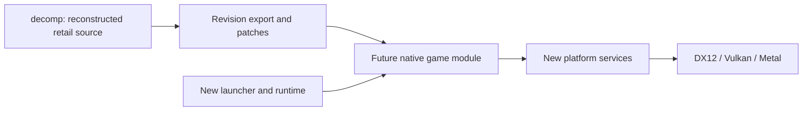

# Architecture

The native host and the matching decompilation develop together. The current
host is a C++20 graphical launcher; its CMake build, native packages and release
pipeline are usable before a game module exists. The launcher uses SDL3 and
Dear ImGui with settings/source logic independent of rendering.

## Source and build boundaries

This repository owns both tracks. `src/` contains new bootstrap, launcher,
data, runtime and platform code. `decomp/` holds faithful reconstructed retail
source and matching configuration; no sibling checkout is required. The future
native game module will consume a revision-identified export of that source
with faithful portability patches. Intentional behavior changes stay in a
separate optional series, with tweaks off by default. Third-party dependencies
remain immutable pins; never edit their checkouts in place.

The matching build uses the original 32-bit compiler and compares functions
against the target executable. The native build uses CMake/Ninja and modern
C++20 compilers. These are different build products; a successful native build
is not a matching result.
The initial candidate is Visual C++ 6.0 SP4. Its compiler stamp agrees with
the dominant Rich-header record, and the generated PDB/comparison fixture is
verified. See [matching setup](../decomp/README.md).

The host is 64-bit. x86_64 and ARM64 are distinct architectures, even though
both targets use little-endian storage. File/save layouts, pointer widths,
`long`, `wchar_t`, alignment and floating-point behavior need explicit handling.

## Platform direction

| Service | Native direction |
| --- | --- |
| Window, input, events, timing and audio device | SDL3 |
| Windows graphics | Dawn native D3D12, with Vulkan selectable |
| macOS graphics, ARM64 and Intel | Dawn native Metal |
| Linux graphics | Dawn native Vulkan |
| Game files | Read/seek interface over installed folders, images and installer archives |
| Settings and saves | Writable user storage, separate from read-only game data |

SDL3 and Dear ImGui are integrated for the launcher, with stb decoding the
declared header image. They build from immutable pinned exports, verified before
each build. Dawn and the game module remain future work. The host does not need
Wii/GX compatibility or a browser runtime.

The launcher uses SDL's 2D rendering interface, preferring DX12, Metal or Vulkan
for its host platform, and can fall back to software. This is independent of
the future Dawn game renderer. Renderer-independent settings code handles UTF-8
paths, bounded settings parsing, atomic replacement and basic source checks.

The retail DirectDraw/GDI operations determine whether adaptation belongs at
the API boundary or at a narrow game-renderer interface. That mapping remains
open; the native backend requirements are fixed. Synthetic GPU diagnostics
will establish each backend before retail rendering is connected. Compilation
and command-line startup alone do not establish GPU or gameplay compatibility.

## Data and game integration

Native ISO 9660/Joliet indexing and bounded file reads are implemented behind
a read/seek interface and the independent `beachlife-data` tool. Folder and
InstallShield cabinet backends follow. Direct reads avoid requiring a permanent
extracted game tree; large compressed members need measured seeking/caching
experiments. [Logical paths](DATA.md) preserve display spelling and normalize
ASCII case/separators without permitting traversal.

The initial source picker checks availability and the ISO container signature;
it does not index game content. Game languages must later be derived from the
selected source's actual localization data. Switching sources must recompute
the available list and reset an unavailable selection. Installer translations
and launcher-interface translations are separate concerns.

Asset previews and subsystem harnesses can advance while matching is incomplete.
Full game launch requires all reachable game code and dependencies in source.
An asset viewer, synthetic scene or stubbed menu does not meet that condition.
The original executable and middleware DLLs are never executed by the port.

Audio decoders, video playback, text/font behavior and save interoperability
are separate increments. Remaster assets and player-visible changes remain
optional layers over the faithful baseline.

## Builds and promotion

The same presets serve local builds and Actions. CMake's `project(... VERSION)`
is authoritative; generated identity adds the source SHA, dirty state, channel,
PR and workflow run. Package manifests record provenance and payload hashes.

PRs build native artifacts for every supported package target. Stable promotion
requires all platform jobs, the Windows package smoke and the aggregate package
validation. Stable rebuilds the merged commit and drafts its CMake version.
Final publication reuses the candidate assets. See [BUILDING](BUILDING.md) and
[RELEASES](RELEASES.md). Packages contain declared outputs and notices, never a
recursive copy of the checkout or original game data.
