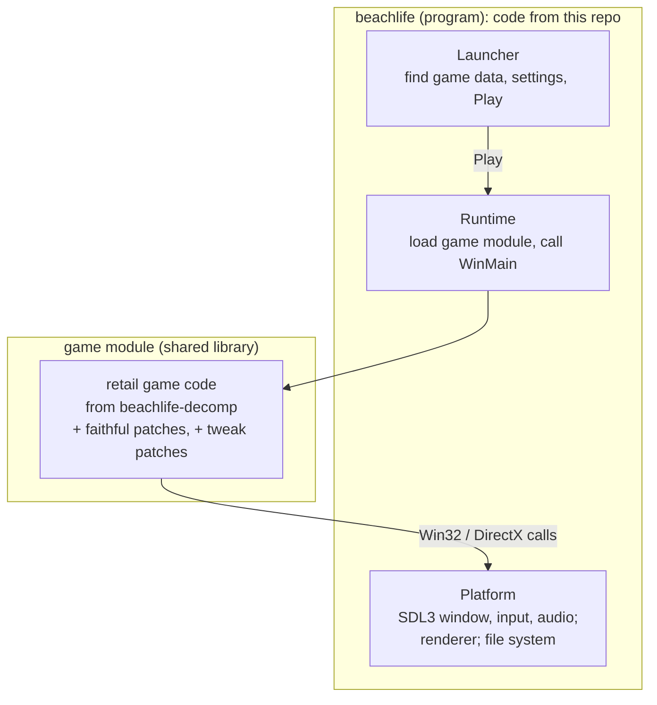

# Architecture

The model is the one Recharged uses for Mario Strikers Charged. Two
binaries, built from two kinds of code that never mix:

- **The program** contains the launcher, the runtime and the platform. All of
  it is new code and lives in `src/`.
- **The game module** is the retail source, compiled natively. Pressing Play
  loads it into the same process, and the runtime calls the game's original
  entry point. From there the game runs its own startup, menus and simulation.

## From the decompilation to the game module

The game's source is never edited by hand in this repository.

1. **Pin.** `extern/beachlife-decomp` is a submodule at an exact commit. A new
   decomp version only enters through a reviewed update of that pin.
2. **Export.** The build copies the decomp's `include/`, `libs/` and `src/`.
3. **Patch.** `patches/beachlife-decomp/series` is applied first. This
   *faithful* series only adapts the code: MSVC 6 C++ dialect, 64-bit pointer
   widths, structures read straight from files, and the hand-over to the
   platform. Game behaviour, timing and bugs stay as they were.
   `patches/beachlife-decomp-tweaks/series` follows with every intended
   change (widescreen, interface scaling, bug fixes, remaster assets). Each
   tweak is optional and off by default.
4. **Compile** with Clang, GCC or MSVC as 64-bit code.

The CPU stays x86 and little-endian (ARM64 Macs too), so unlike the Wii port
no data needs byte swapping. The work is in 64-bit cleanliness and in what the
game expects from Windows.

## What replaces Windows

Filled in once the decomp's `tools/peinfo.py` has run on the real executable:

| The game uses | The platform provides |
| --- | --- |
| Win32 window, messages, timers | SDL3 |
| Files, registry, CD checks | a virtual file system over the installed folder or the disc image; settings in an ini file |
| DirectDraw / Direct3D (version to be confirmed) | a native renderer, see below |
| DirectSound, Miles or similar (to be confirmed) | SDL3 audio, with decoders for the game's sound formats |
| Bink or Smacker videos, if any | FFmpeg's decoders, or skipped at first |
| DirectInput, if any | SDL3 |
| CD audio tracks, if any | read from the BIN/CUE image, played through SDL3 |

## The renderer: two options

A wrapper such as dgVoodoo translates the original executable's DirectX calls
at runtime. Here the original executable never runs, and the renderer can be
replaced at one of two levels:

- **At the API.** Implement the subset of DirectDraw/Direct3D the game calls,
  on SDL3 GPU or OpenGL, and leave the game's rendering code as it is. This is
  what isle-portable did for LEGO Island ("miniwin") and what Aurora does for
  GX in Recharged. Most faithful, smallest faithful series.
- **At the game's own renderer.** If the game hides DirectX behind its own
  renderer classes, reimplement those. Less API to emulate and easier
  arbitrary resolutions, but a larger patch.

The decision comes after the decomp has mapped the rendering code. For a game
with pre-rendered isometric sprites the second option may be the better one.

## Reading the game data

Nothing is extracted. The file system reads, in this order of preference:

1. an installed game folder,
2. a disc image (ISO 9660, or BIN/CUE if the disc has audio tracks),
3. installer archives inside the image, if the data only exists there.
   [unshield](https://github.com/twogood/unshield) reads InstallShield cabinets,
   if that is what the disc uses.

## Remaster assets

A layer over the original data: the file system looks in the remaster folder
first, then in the original data. Higher-resolution sprites also need the
renderer to separate the game's logical coordinates from screen pixels, the
same work as widescreen support. What the remaster contains is still unknown.

## Saves

Where the original writes structures straight to disk and those contain
pointers or 32-bit layout, the faithful series serialises them explicitly, so
saves stay interchangeable with the original game.

## What can start before the decomp is complete

The game module needs every game function in source. These parts do not:

- the file system over folders, images and installer archives
- window, input, audio and timing on SDL3
- the launcher
- an asset viewer built on the decomp's format readers
